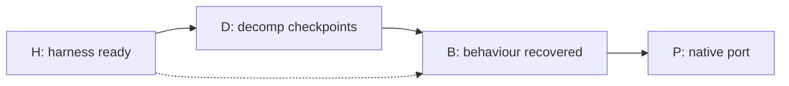

# Acceptance criteria

Four levels, each with its own evidence. A pass at one level never stands in for another:
a roundtrip is not source, a match is not behaviour, a working port is not a match.



## H — harness ready to start decompiling

All must hold on the macOS arm64 host, from a clean checkout plus the private inputs, with no
undocumented manual steps.

| Gate | Requirement | Evidence |
|---|---|---|
| H1 Input identity | CCI sha256 pinned; decrypted CXI/`code.bin`/exheader sha256 pinned once available; import refuses any mismatch | `config/title.json`, failing-hash test |
| H2 Extraction | Exheader parsed (code-set layout, BSS, dependencies, compression flag); `code.bin` decompressed; ExeFS and RomFS extracted with a per-file manifest; CROs listed | `inputs` manifest with sha256 per extracted file |
| H3 Zero-C baseline | The build pipeline reproduces `code.bin` and the stored ExeFS `.code` (exact recompression) with no credited source. This design never splits original bytes into objects, so there is no split-and-relink step to prove; credited ranges are rebuilt only from compiled objects | baseline receipt (input manifest + output hashes) |
| H4 Denominators | Frozen function catalogue (stable identity = image + address + size, ARM/Thumb mode, segment) and a complete-image map where every `code.bin` byte is in exactly one classified range; changes only via a reviewed revision in a hash chain | `docs/progress-catalogues/`, map file, history |
| H5 Compiler identified | ARMCC version/build and flags chosen by evidence: ≥10 independent functions byte-match across distinct features (leaf, calls/BL, literal pool, switch table, struct access, C++ method/vtable, VFP if used, Thumb if used); provenance (URL, sha256) recorded | `config/compiler_profiles.json`, evidence records |
| H6 Match loop | One command compiles a candidate under the unit's profile, links it in place with strict relocations, and reports exact / extent-differs / mismatch per function with a diff; deterministic; per-compile time measured | `tools/match.py` + tests |
| H7 Integration | A matched function's object replaces the original bytes in a full build and `code.bin` stays byte-identical; the receipt records every input | receipt with ≥1 C-credited function |
| H8 Progress | objdiff-format `report.json` from catalogue + matches; CI workflow uploads `<version>_report`; ByteMatch registration documented | `ci/progress_report.py`, `.github/workflows/progress.yml` |
| H9 Tests | Suite covers verifier failure cases (wrong input hash, one-byte mismatch, unknown function in matches, catalogue drift, unclassified bytes) | `tests/`, green run |
| H10 Docs | README, AGENTS.md (roles, single-writer rule, gates), STATUS.md / RESUME.md current-first, known-issues template | files |
| H11 Pilot | ~10 stratified functions matched through the loop by agents, with time, attempts and model recorded | pilot report |

Passing H1–H11 is "good enough to start decompiling" at scale (parallel author waves).

## D — decomp checkpoints (per accepted batch)

Adapted from the Shiren lean contract r3. Every accepted checkpoint needs:

1. **Source binding:** frozen manifest of the exact source tree.
2. **Per-unit compile match** for every changed unit; no silently skipped unit.
3. **Full build equality:** `code.bin` (and CROs) byte-identical, reproduced by two fresh builds.
4. **Interfaces:** whole-tree audit of cross-unit declarations; real types on every interface.
5. **Source policy:** no inline asm standing in for C, no byte blobs standing in for code or data, no
   fake matches without a recorded qualification. Documented ARMCC extensions (`__svc`, CP15 named
   registers, intrinsics) count as C per `docs/rulings/2026-10-17-armcc-extensions.md`.
6. **Independent review:** one certificate per changed function, plus two fresh whole-receipt reviews
   (cross-family where possible). The integrator never reviews its own work.
7. **Finalize once:** progress recorded in a hash-chained history; a reviewed denominator plan if the map
   changed. No retry-to-pass: a failed gate is recorded and its cause fixed.
8. **Known issues** published per checkpoint: skips, rulings, preserved original bugs, qualifications.

Implemented by `tools/accept.py` (records in `accept/<checkpoint>/`, history in
`docs/progress-history.jsonl`):

| Step | Command | Enforces |
|---|---|---|
| prepare | `accept.py prepare --checkpoint cNNN-name --candidates config/candidates/<file>.json` | 1, 2, 3 (two fresh `build.py` builds of ledger + candidates, identical outputs), full suite; exclusive, FAIL kept |
| review | `accept.py review --checkpoint … --reviewer … --family … --verdict … --notes …` | 4, 5, 6: reviewer re-derives, verdict bound to the exact prepare and source hashes |
| finalize | `accept.py finalize --checkpoint …` | 7: once; needs PASS prepare, ≥1 bound passing review, no FAIL, nothing changed since prepare |
| verify | `accept.py verify` (CI) | `config/matches.json` equals the last finalized ledger and every credited source its accepted hash |

Scale note for this project: the lean form is one review per checkpoint covering every changed
function (per-function notes inside it), from another model family than the authors where
possible. Item 8 lives in `docs/known-issues-<checkpoint>.md` when a checkpoint has any.

### Checkpoint linker/literal selection

`prepare` accepts independent `--linker-model` and `--literal-model` choices. Omitting them
retains `armlink5-inline-branchnop-v2` / `none`; the previous checkpoint's opt-in is **not**
silently inherited. For example, after the applicable gate revisions and independent reviews:

```sh
python tools/accept.py prepare --checkpoint cNNN-name --candidates config/candidates/<file>.json \
  --linker-model armlink5-inline-branchnop-v3 --literal-model anonymous-string-records-v1
```

CLI arguments are the per-checkpoint authority, rather than optional manifest fields: they use
the same identifiers as the author/build tools, make model selection visible at invocation, and
do not silently change an existing candidate manifest's interpretation. Before any prepare gate
or build runs, the immutable checkpoint directory gets `selection.json` with both explicit
choices. Both fresh builds receive those exact values, even for defaults. Prepare fails if
either receipt disagrees with the selection or the builds disagree with each other.

New prepare/history records use schema 2. They bind the selection hash and both complete receipt
hashes, including every literal mapping and removed helper. Review/finalize recheck this closure;
`verify` checks it without ROM inputs. The selector's creation boundary is fixed after
pre-selector `c007` (sequence 7): this change merges only after `c007` finalizes and before
`c008` prepares. **Sequence 8 and every later checkpoint require `selection_sha256`**,
irrespective of mutable schema/model labels. Before that boundary, a
selection artifact, selection/receipt binding, build-input summary or non-default model also
requires the selected-checkpoint closure. Lowering/deleting schema metadata cannot opt selected
evidence into the legacy path.

For every checkpoint, `verify` binds the prepared record's hash and cross-checks both full
receipts' models against the prepared and historical models. Only genuinely pre-selector,
default-model evidence can use legacy model omissions (v2 / `none`); no historical artifact or
recorded model is rewritten or opted in retroactively.

`model_uses` lists **every** R1 caller, removed-helper unit (including `functions: []`), L1 owning
unit and full pool mappings, including unchanged sources. `model_changes` compares both choices
with the last accepted checkpoint. On a model transition, `model_reviews` reopens every current
R1 caller and, conservatively, every credited function of each current L1 pool-owning unit:
the linker does not claim a recovered per-function literal-reference graph. These required rows
join new/revised functions and R1 helper/header dependencies; R1 provenance rows remain QUALIFIED.
Inspect both full receipts, not only the summary. A selector is not gate adoption: L1/R1 still
require their independently reviewed, frozen gate revisions before a real prepare uses them.
The combined proposal is `scratch/integrator/adopt-r1-l1/GATES-DRAFT.md`; `docs/GATES.md` is not
changed by implementing the selection path.


Classified, never credited as C: SDK/library code proven identical to a known library, compiler
runtime helpers, veneers/thunks, handwritten assembly, generated tables, data with format witnesses.

"Done" for the decomp: every catalogued function matched or honestly classified, the complete-image map
closed, a final byte-identical receipt, progress recorded. Readability (evidence-backed names,
subsystem folders, types, docs) counts toward done, as it did for Shiren; names live in an overlay keyed
by stable identity.

## B — behaviour recovered

| Gate | Evidence |
|---|---|
| B1 Formats | Every RomFS file classified; question/dictionary/stroke formats have reversible decoders with round-trip fixtures |
| B2 Question engine | Selection, grade and mock-exam rules documented from matched source, checked against fixed-seed emulator sessions |
| B3 Marking | Answer checking and handwriting grading reproduced on golden pen traces |
| B4 Saves | Save format decoded; read/write round-trips |
| B5 Traces | Golden trace set (input strokes → shown result) stored privately with provenance |

## P — native port

The port test plan in `POST_DECOMP.md` (asset decoding, question engine, recogniser, form grading,
persistence, Windows input, iPad input, shipping hygiene). A release additionally requires a rights
review of what the distributable contains.

## Reporting rules

- Three kinds of number, never conflated: accepted (receipt + progress record), candidate (private,
  unaccepted), whole-image (map coverage).
- Label inference as [INFERENCE]; state qualifications at the claim.
- Byte percent is the headline measure; function count alone misleads (Digimon World DS: 65% of
  functions but 23% of code bytes).
